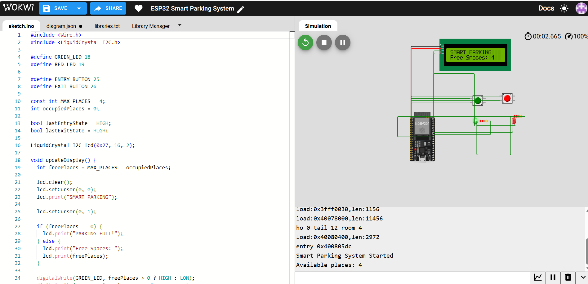

# ESP32 Smart Parking System
## Project Simulation

A smart parking prototype developed using ESP32 and Arduino C++,
designed and tested in the Wokwi simulator.

## Project Overview

The system tracks the number of available parking spaces
in a parking area with a maximum capacity of four vehicles.

Two push buttons simulate vehicle entry and exit.

## Features

- Vehicle entry and exit counting
- Real-time display of available parking spaces
- 16x2 I2C LCD display
- Green LED when parking spaces are available
- Red LED when the parking area is full
- Maximum capacity of 4 vehicles
- Serial Monitor output for testing

## Technologies

- ESP32
- Arduino C++
- Wokwi Simulator
- I2C LCD 16x2
- LEDs and push buttons

## Pin Connections

| Component | ESP32 Pin |
|-----------|-----------|
| Green LED | GPIO 18 |
| Red LED | GPIO 19 |
| Entry Button | GPIO 25 |
| Exit Button | GPIO 26 |
| LCD SDA | GPIO 21 |
| LCD SCL | GPIO 22 |

## Simulation

Try the project online:

[Open Smart Parking System in Wokwi](https://wokwi.com/projects/477852340659187713)

## How It Works

1. Press ENTRY to simulate a vehicle entering.
2. Press EXIT to simulate a vehicle leaving.
3. The LCD shows the number of free parking spaces.
4. When all four spaces are occupied, the red LED turns on
   and the LCD displays "PARKING FULL!".
5. When a space becomes available, the green LED turns on.

## Note

This is a simulation-based prototype. Push buttons are used
instead of physical vehicle detection sensors.
